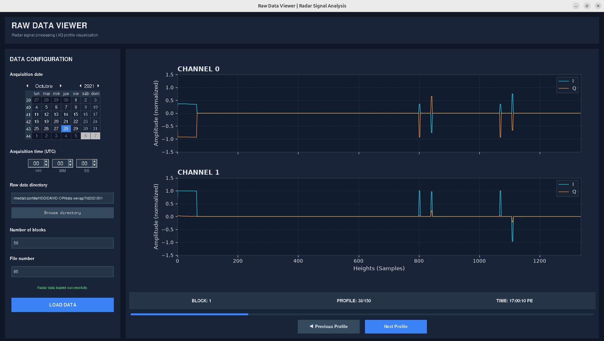

# Overview

This repository provides a tool for generating and visualizing raw data profiles acquired during different experiments at the Jicamarca Radio Observatory (JRO). The data are stored in `.r` files, a custom binary format that contains both metadata and experimental data collected by Jicamarca's radar systems. 
Although a raw data reader and visualization tool already exists, it is currently limited to Windows operating systems. This project aims to overcome that limitation by providing a cross-platform solution, initially focused on Linux, which is the primary operating system used for experiment development and data processing at JRO. Ultimately, the goal is to make the tool compatible with different operating systems.

## Methods

The project implements the following main functionalities:

- **Data reading:** parsing `.r` files according to the data structure and format used at Jicamarca.
- **Data visualization:** displaying raw data profiles using Python's Tkinter library and its graphical interface components.

## Results

The visualization tool can be launched by executing `radar_profiles_front.py`, which provides a graphical interface for configuring the data to be displayed. The following parameters can be selected:

- **File location:** directory containing the `.r` files.
- **Date and time:** acquisition date and time.
- **Number of blocks:** number of data blocks to be processed.
- **File number:** specific file number to be loaded.

  

  <em>Raw data plot corresponding LP/DP Faraday experiment</em>

## Repository Structure

- `legacy/`: early exploratory scripts and development drafts.
- `radar_profiles_front.py`: frontend script responsible for the graphical user interface.
- `radar_profiles_back.py`: backend script responsible for data reading and processing.

## Requirements

- Python
- NumPy
- Matplotlib
- Tkinter
- CustomTkinter

## Author

**David Fernando Evangelista Cuti** 
Radar Operations Analyst – Jicamarca Radio Observatory (JRO), Peru.
